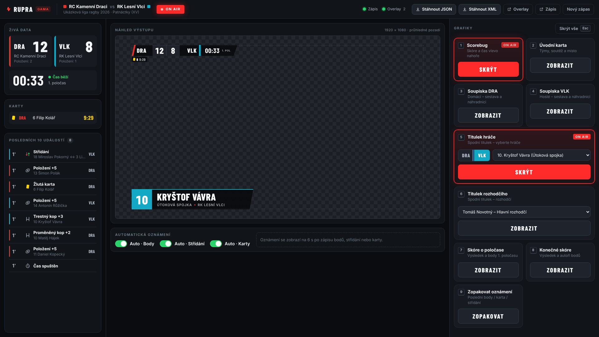
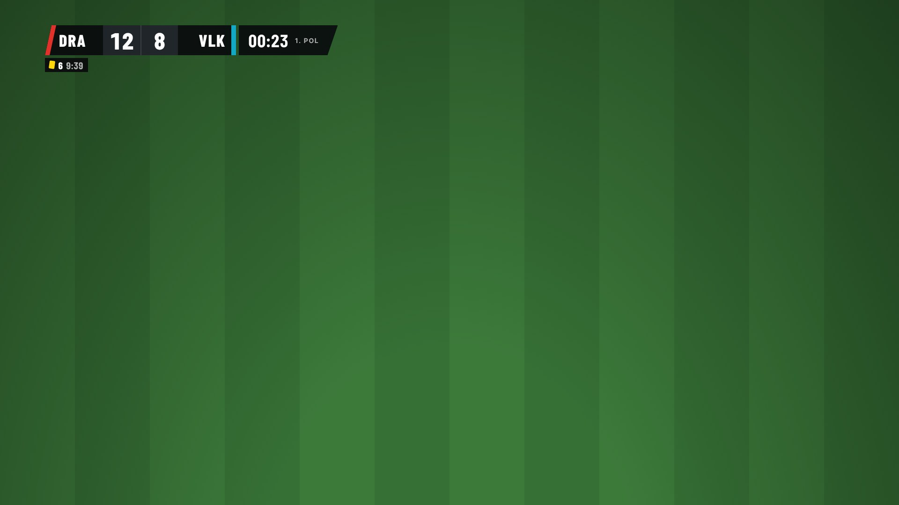
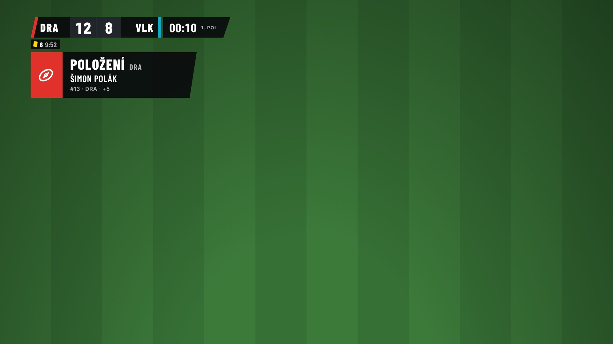
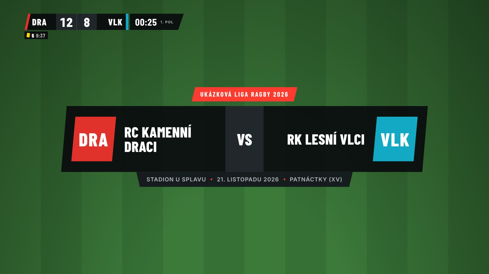
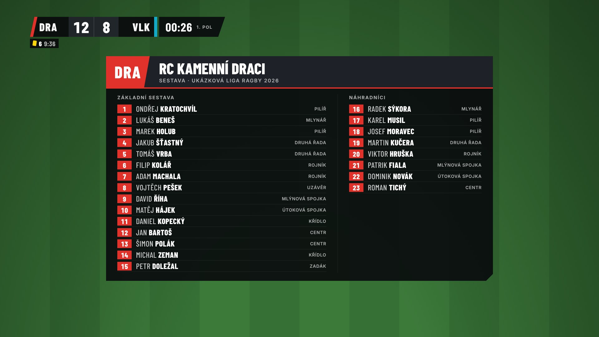
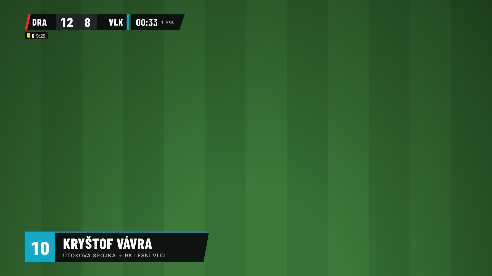
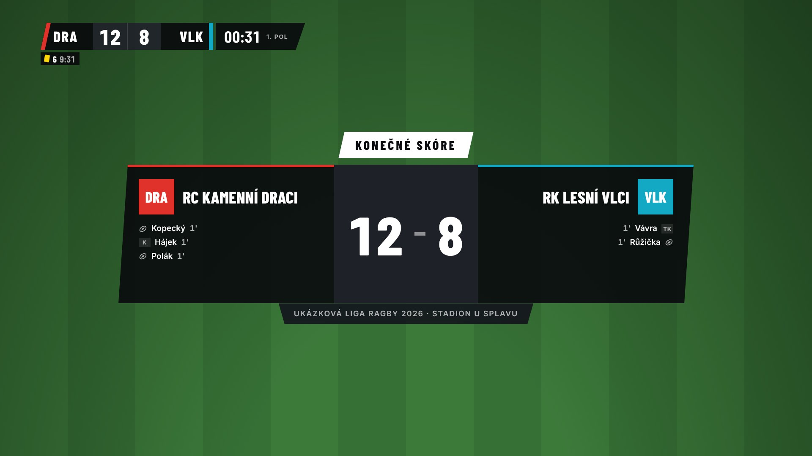
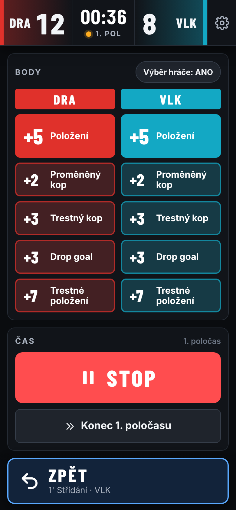
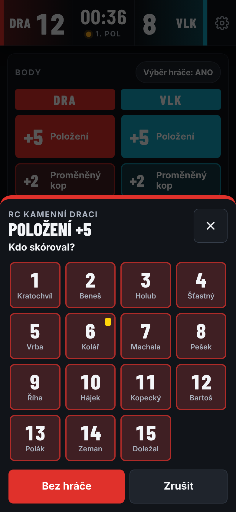
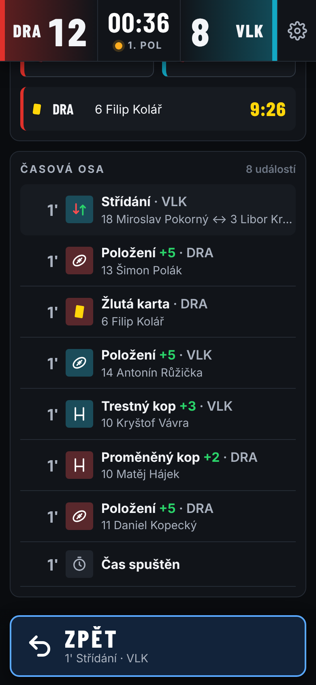

# Rupra – živá grafika pro ragbyové streamy (gama verze)

Rupra propojuje tři obrazovky:

| Routa | Kdo ji používá | Na čem |
|---|---|---|
| **`/zapis`** | zapisovatel na stadionu: body, čas, střídání, karty, ZPĚT | mobil (tmavý režim, ovládání palcem) |
| **`/panel`** | klient doma: náhled výstupu, spouštění grafik, export dat | desktop |
| **`/overlay`** | výstup do vysílání: 1920 × 1080, průhledné pozadí | vMix → Browser input |

Změna zapsaná na `/zapis` se do zlomku sekundy projeví na `/panel` i `/overlay`. Při testu na jednom počítači to bylo kolem 20 ms.



---

## Spuštění

Potřebujete Node.js 18 nebo novější.

```bash
npm install
```

```bash
npm run dev
```

Pak otevřete <http://localhost:5173>. Rozcestník odkazuje na všechny tři obrazovky.

Další příkazy:

```bash
npm run build      # produkční build do dist/
```

```bash
npm run preview    # spustí produkční build lokálně
```

Dev server běží s `--host`, takže se k němu připojíte i z mobilu ve stejné Wi-Fi: `http://<IP-počítače>:5173/zapis`.
**Pozor:** gama verze synchronizuje jen záložky v **jednom prohlížeči na jednom počítači** (viz níže). Mobil připojený přes Wi-Fi stav uvidí, ale s ostatními obrazovkami se nesesynchronizuje, dokud nebude hotový SupabaseAdapter.

## Jak testovat ve třech záložkách

1. Spusťte `npm run dev`.
2. Ve **stejném prohlížeči** otevřete tři záložky nebo okna:
   - `http://localhost:5173/zapis`: zúžte okno, nebo zapněte v DevTools režim mobilu (Ctrl+Shift+M),
   - `http://localhost:5173/panel`,
   - `http://localhost:5173/overlay`.
3. V panelu stiskněte **1** (scorebug). Grafika se objeví v náhledu i v záložce overlaye.
4. V zápisu klepněte na **VÝKOP**, pak na **+5 Položení** a vyberte hráče. Skóre se změní všude a na 6 s naskočí oznámení „POLOŽENÍ“.
5. Zkuste **ZPĚT** (vrátí poslední akci), **F5** v libovolné záložce (stav i běžící čas zůstanou) a srovnejte čas na všech třech obrazovkách.

Indikátor připojení v horní liště zápisu:
🟢 vidí další obrazovku (panel nebo overlay) · 🟠 synchronizace funguje, ale nikdo jiný není otevřený · 🔴 synchronizace nefunguje.

### Ukázka v jedné stránce (artefakt)

Pro rychlé předvedení jsou všechny tři obrazovky i v jedné stránce nad rozehraným ukázkovým zápasem (`demo.html`, `src/demo/`). Sestavení do jednoho HTML souboru:

```bash
node scripts/build-artifact.mjs
```

Výsledek je `dist-demo/rupra-demo.html`. V této verzi se export JSON/XML zobrazí v okně ke zkopírování, protože vložená stránka nesmí stahovat soubory.

### Automatický smoke test (volitelný)

```bash
npm i -D playwright && npx playwright install chromium
```

```bash
node scripts/smoke-test.cjs
```

Test běží proti spuštěnému `npm run dev`. Ověří synchronizaci, refresh, shodu času, UNDO, poločasy a odpočet karet. Screenshoty všech grafik uloží do `screenshots-tmp/`.

## Vložení `/overlay` do vMixu

1. **Add Input → Web Browser**.
2. URL: `http://<adresa-serveru>:5173/overlay` (po nasazení adresa hostingu).
3. Rozlišení **1920 × 1080**.
4. Průhlednost: Browser input ve vMixu podporuje alfa kanál sám a stránka má průhledné pozadí, takže stačí input vložit jako **Overlay** (tlačítka 1–4 u inputu) nad kameru. Nic se neklíčuje.
5. Grafiky se ovládají z `/panel`, ne z vMixu. Overlay může běžet pořád zapnutý.
6. Po změně verze aplikace dejte v nastavení inputu **Refresh**.

Ve vMixu i v náhledu panelu se animuje jen `transform` a `opacity`, takže vjezdy a odjezdy jsou plynulé. Title-safe okraj je 5 % (96 px a 54 px).

### vMix Data Sources

V panelu jsou tlačítka **Stáhnout JSON** a **Stáhnout XML** s aktuálním stavem. XML má na první úrovni plochá pole (`HomeScore`, `AwayScore`, `Clock`, `Period`, `HomeShort`…), která se ve vMixu snadno namapují. Zatím jde o jednorázový export. Živý endpoint je v seznamu níže.

## Grafiky a ovládání panelu

| Klávesa | Grafika |
|---|---|
| 1 | Scorebug: skóre, čas, poločas, žluté karty s odpočtem |
| 2 | Úvodní karta zápasu |
| 3 / 4 | Soupiska domácích / hostů (sestava + náhradníci) |
| 5 | Spodní titulek hráče (tým a hráče vyberete v dlaždici) |
| 6 | Spodní titulek rozhodčího |
| 7 | Skóre o poločase (s autory bodů) |
| 8 | Konečné skóre |
| 9 | Zopakovat poslední oznámení |
| Esc | Skrýt vše |

Středové grafiky (2–4, 7, 8) se vzájemně vylučují, stejně tak oba spodní titulky. Automatická oznámení (body, střídání, karty) mají každé vlastní přepínač **Auto**.

## Pravidla

- Body: položení 5, proměněný kop 2, trestný kop 3, drop goal 3, trestné položení 7.
- **XV**: 2 × 40 min, žlutá karta 10 min, 15 + 8 hráčů. **Sedmičky**: 2 × 7 min, žlutá 2 min, 7 + 5 hráčů. Variantu zvolíte v nastavení zápasu (ozubené kolo v zápisu).
- Odpočet žluté karty běží jen při běžícím čase. Červená karta = hráč trvale mimo, už nejde vystřídat zpět.
- Ve 2. poločase čas navazuje (40:00 → 80:00).

## Architektura

```
src/
  domain/          čistá logika bez Reactu
    types.ts       stav zápasu, akce (SCORE, CLOCK_START, CLOCK_STOP, NEXT_HALF, SUB, CARD, UNDO, SHOW_GRAPHIC…)
    reducer.ts     kořenový reducer + přehrávání událostí (event sourcing)
    clock.ts       čas z časových razítek, odpočet karet
    rules.ts       body a varianty XV / 7s
    exporters.ts   JSON a XML pro vMix
    sampleData.ts  ukázkové týmy
  sync/
    SyncAdapter.ts rozhraní: getState, dispatch, subscribe (+ stav připojení)
    LocalAdapter.ts   BroadcastChannel + localStorage
    SupabaseAdapter.ts kostra s TODO
  routes/zapis | panel | overlay
  styles/tokens.css   designový systém (barvy, typografie, rádiusy, stíny, pohyb)
```

- **Jeden objekt stavu.** Zápasové akce se ukládají jako události s časovým razítkem. Živý stav (skóre, kdo je na hřišti, karty, časová osa) se z nich přepočítává. **UNDO** odebere poslední událost a stav znovu přepočítá, takže vrací přesně i čas (např. vrácené STOP znovu „rozběhne“ hodiny od původního startu).
- **Čas** se nepočítá přes `setInterval`. Ukládá se `startedAt` a nashromážděný čas a všechny obrazovky z toho dopočítávají totéž, i po refreshi.
- **Synchronizace** je schovaná za `SyncAdapter`. Přepnutí se dělá v `.env` (viz `.env.example`): `VITE_SYNC_ADAPTER=local | supabase`.

## Co chybí do ostré verze

- [ ] **SupabaseAdapter**: Postgres + Realtime, synchronizace mezi zařízeními přes internet (mobil na stadionu ↔ klient doma). Návrh je v `src/sync/SupabaseAdapter.ts`: tabulka akcí, serverová časová razítka, Presence pro indikátor připojení, offline fronta pro zápis, RLS.
- [ ] **Synchronizace hodin**: měřit offset mezi zařízením a serverem, aby čas seděl i na různých zařízeních.
- [ ] **Hosting**: statický build (`dist/`) na Vercel, Netlify nebo Cloudflare Pages s SPA fallbackem na `index.html`, k tomu HTTPS a vlastní doména.
- [ ] **Přístupy**: přihlášení nebo tajný odkaz pro zapisovatele a režii. Overlay jen pro čtení.
- [ ] **Loga týmů**: upload do Supabase Storage a zobrazení místo zkratky (badge je na to připravený).
- [ ] **Živý datový endpoint** pro vMix Data Sources (URL s JSON/XML) místo stahování souboru.
- [ ] Více zápasů najednou (ID zápasu v URL), historie zápasů, statistiky.
- [ ] Prodloužení, „zlatý bod“ u sedmiček, HIA a krvavá střídání.
- [ ] Self-hosting písem (vMix bez internetu). Teď se načítají z Google Fonts.
- [ ] PWA / offline režim pro zápis na stadionu se slabým signálem.

## Screenshoty

Overlay je zde vyfocený přes simulovaný trávník, aby byla vidět čitelnost nad obrazem. Ve skutečnosti je pozadí průhledné.

| | |
|---|---|
|  |  |
|  |  |
|  |  |

| Zápis | Výběr hráče | Časová osa |
|---|---|---|
|  |  |  |
